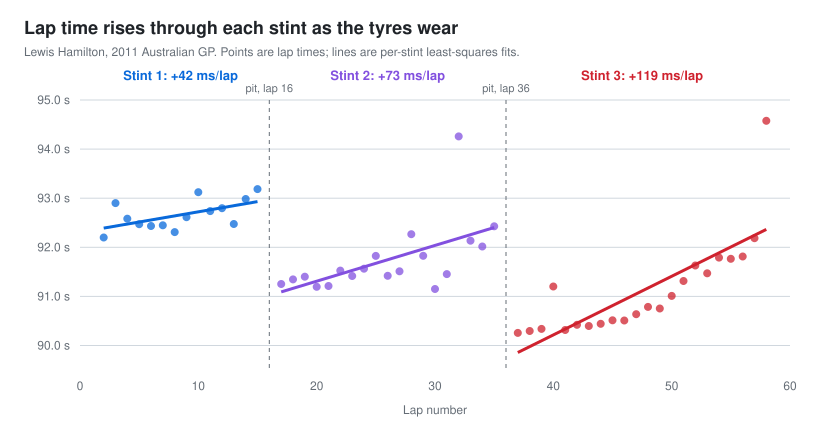

# Modelling Tyre Degradation in Formula 1


**How fast do lap times drop off as tyres wear, and can a simple linear model capture it?**

This project uses lap-by-lap timing data from Lewis Hamilton's 2011 Australian Grand Prix to model **tyre degradation**: the steady loss of lap time as tyres wear through a stint. It splits the race at the pit stops and fits one regression per stint. The slope of each line estimates how many milliseconds the car loses per lap.

<p align="center">
  
</p>

## Key findings

| Stint | Laps | n | Degradation (ms/lap) | SE | R² | Adj. R² |
|---|---|---:|---:|---:|---:|---:|
| 1 | 2–15 | 14 | **+41.5** | 17.0 | 0.331 | 0.275 |
| 2 | 17–35 | 19 | **+72.8** | 25.2 | 0.329 | 0.289 |
| 3 | 37–58 | 22 | **+119.4** | 20.7 | 0.624 | 0.605 |

- **Every stint shows significant degradation.** All three slopes are positive, and each is more than twice its standard error.
- **Degradation accelerated through the race.** The final stint lost about 0.12 s per lap, nearly 3× the rate of the first. Over the 22-lap stint, that adds up to about 2.5 s per lap by the end.
- **The model generalizes reasonably to another driver.** Applied to a second driver's opening stint from the same race, the stint 1 model predicts lap times with a **mean absolute error of 283 ms** (0.3% of a ~92.5 s lap; laps 2–13).

## Data

Lap times come from the [Formula 1 Race Data](https://www.kaggle.com/datasets/cjgdev/formula-1-race-data-19502017) dataset on Kaggle (`lapTimes.csv`). They were filtered to the 2011 Australian Grand Prix (58 laps, Albert Park), where Hamilton finished 2nd behind Sebastian Vettel.

| File | Contents |
|---|---|
| `data/hamilton_full_race.xlsx` | All 58 of Hamilton's laps, used for the exploratory plot |
| `data/hamilton_stint{1,2,3}.xlsx` | Hamilton's laps per stint, excluding the start lap and pit in/out laps. These are the modelling data |
| `data/test_driver_stint{1,2,3}.xlsx` | A second driver's stints from the same race, used as a hold-out test set |

Each file has two columns: `lap` and `milliseconds`.

## Methods

1. **Exploration:** a scatter plot of lap time against lap number for the whole race shows three separate upward trends. These match the three sets of tyres, separated by pit stops on laps 16 and 36.
2. **Segmentation:** laps that don't reflect tyre performance are excluded: the standing-start lap 1 and the pit in/out laps.
3. **Modelling:** one simple linear regression per stint,

   $$\text{lap time}_i = \beta_0 + \beta_1 \cdot \text{lap}_i + \varepsilon_i$$

   where $\beta_1$ is the degradation rate in ms per lap.
4. **Validation:** goodness of fit (R², adjusted R²), residual-vs-fitted and residual-vs-lap plots, normal Q–Q plots, and out-of-sample prediction on a second driver.

## Diagnostics and limitations

- **Linearity is only approximate.** The residual plots show some structure. In stint 3, lap times stay almost flat for about 10 laps and then climb steeply. That pattern suggests non-linear degradation (a "cliff"), which a quadratic or piecewise model would capture better.
- **Outliers move the slopes noticeably.** The report flags three laps as anomalies: lap 32 (Hamilton ran wide), lap 40 (lapped traffic) and lap 58 (the final lap). Refitting without them changes the stint 2 slope from 72.8 to **48.1** ms/lap and the stint 3 slope from 119.4 to **96.7** ms/lap. The ranking (stint 3 > stint 2 > stint 1) holds either way.
- **Fuel burn-off is not modelled.** Cars get lighter, and therefore faster, as fuel burns off. The effect is commonly estimated at a few hundredths of a second per lap. It masks some of the wear, so these slopes probably *understate* the true tyre degradation.
- **Tyre compounds are uncertain.** The written report labels the stints hard–hard–soft in its main text but soft–soft–hard elsewhere. Race reports suggest Hamilton most likely took the harder compound at his lap-36 stop. I therefore compare the stints by number rather than by compound.
- **Other omitted factors:** track evolution, traffic, driver push level, car setup and tyre temperature.
- **Small samples:** 14–22 laps per stint, so the slopes have wide standard errors.

## Repository structure

```
.
├── R/
│   └── tire_degradation.R      # Full analysis: plots, models, diagnostics, test set
├── data/                       # Lap-time data (xlsx)
├── figures/
│   └── stint_degradation.svg   # README figure
├── scripts/
│   └── make_figures.py         # Regenerates the README figure (Python stdlib only)
├── report/
│   └── written_report.pdf      # Full written report with diagnostics plots
└── F1Project.Rproj
```

## Reproducing

From the repository root, run the analysis:

```bash
Rscript R/tire_degradation.R
```

It needs the `readxl` and `ggplot2` packages, and writes plots to `figures/`. To regenerate the README figure:

```bash
python3 scripts/make_figures.py
```

## Skills demonstrated

`Simple linear regression` · `Residual diagnostics` · `Out-of-sample validation` · `Outlier sensitivity analysis` · `Domain-driven data segmentation` · `R (lm, ggplot2, readxl)` · `Communicating model limitations`

## References

- G, Chris. *Formula 1 Race Data*. Kaggle, 2017. https://www.kaggle.com/datasets/cjgdev/formula-1-race-data-19502017
- Pontin, S. (2023). *AI-Based Race Strategy Assistant and Car Data Monitor*. Luleå University of Technology.
